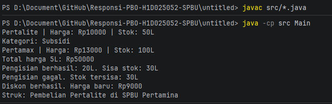

# Responsi Praktikum Pemrograman Berorientasi Objek (PBO)

## 1. Identitas Mahasiswa
- **Nama**        : Timotius Willy Narendra
- **NIM**         : H1D025052
- **Digit Akhir** : 2
- **Tema Sistem** : SPBU (Sistem Transaksi Pengisian Bahan Bakar di SPBU)

---

## 2. Petunjuk Compile dan Run Melalui Terminal

Pastikan terminal dibuka pada direktori proyek (sejajar dengan folder `src`).

### Langkah 1: Compile Program
Jalankan perintah berikut untuk mengompilasi seluruh file Java yang ada di dalam folder `src`:
```bash
javac src/*.java
```
### Langkah 2: Run Program
Jalankan class utama (Main) dengan mengarahkan classpath ke folder src:
```bash
java -cp src Main
```

## 3. Screenshot luaran program
